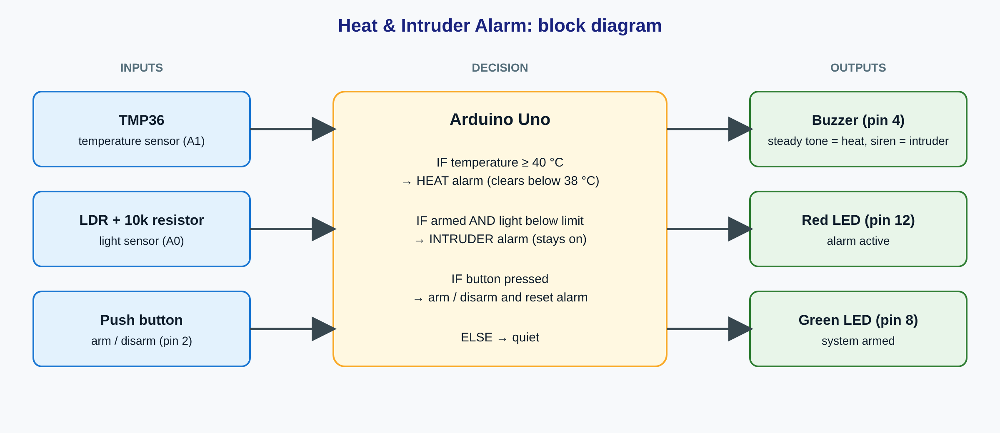

# Day 25: Review & Mini Project

## Overview
For the Week 5 review I chose the **Heat & Intruder Alarm** as my mini project and built it in Tinkercad Circuits. It combines a temperature sensor, a light sensor, a button, a buzzer and two LEDs in one system. I planned it with a block diagram and a parts list, built it in stages, and chose the limits by testing.

## Concepts Explored
- The input → decision → output pattern used in every project
- Planning with a block diagram and a parts list before wiring
- Testing in stages: each sensor alone, then the outputs alone, then everything together
- Reading a TMP36 and an LDR voltage divider with `analogRead()`
- Choosing limits by testing instead of guessing
- Hysteresis: a separate on and off limit so an alarm does not flicker
- A button with `INPUT_PULLUP` to arm and disarm the system
- Using `tone()` and `noTone()` for a steady tone and a two-tone siren
- Timing the siren with `millis()` instead of `delay()`
- Tidy code: named constants for pins and limits, and comments for each section

## What I Built
**Project:** Heat & Intruder Alarm

**What it does:** It sounds an alarm when the temperature gets too high, and when the light level drops while the system is armed.

**How it works:** The Arduino reads the TMP36, the LDR and the button. If the temperature reaches the heat limit, the heat alarm turns on with a steady tone, and it only turns off again after the temperature falls a few degrees lower. When the system is armed with the button (green LED on), a drop in light below the light limit starts the intruder alarm, a two-tone siren that stays on until the button is pressed. The red LED lights during either alarm.

**Build stages:**
1. Temperature sensor alone in the Serial Monitor.
2. Light sensor alone in the Serial Monitor.
3. LEDs, buzzer and button alone.
4. Everything combined into the final alarm.

## Block Diagram

## Parts List
| Part | Quantity | Pin |
|---|---|---|
| Arduino Uno R3 | 1 | n/a |
| Breadboard | 1 | n/a |
| TMP36 temperature sensor | 1 | A1 |
| LDR (light sensor) | 1 | A0 |
| 10 kΩ resistor (LDR divider) | 1 | A0 to GND |
| Push button | 1 | pin 2 (INPUT_PULLUP) |
| Piezo buzzer | 1 | pin 4 |
| Green LED (armed) | 1 | pin 8 |
| Red LED (alarm) | 1 | pin 12 |
| 220 Ω resistors (one per LED) | 2 | in series with each LED |
| Jumper wires | several | n/a |

## Limits I Chose
| Value | Chosen | Why |
|---|---|---|
| Light reading, bright | 974 | Measured with the LDR test sketch |
| Light reading, dark | 54 | Measured with the LDR test sketch |
| Light limit | 500 | About halfway between bright (974) and dark (54), so a shadow clearly drops below it |
| Heat alarm on | 40 °C | Clearly hotter than normal room temperature, so it is a real warning |
| Heat alarm off | 38 °C | 2 °C lower than the on limit so the alarm does not flicker near the limit |

## Visuals
**Temperature sensor test**

**Light sensor test**

**Outputs and button test**

**Heat alarm: red LED on and steady tone**

**Intruder alarm: armed, light dropped, siren on**

**Final circuit**

## Files
- [Day25_TMP36_Test.ino](../Projects/Day-25/Day25_TMP36_Test.ino) – temperature sensor test
- [Day25_LDR_Test.ino](../Projects/Day-25/Day25_LDR_Test.ino) – light sensor test
- [Day25_Outputs_Test.ino](../Projects/Day-25/Day25_Outputs_Test.ino) – LEDs, buzzer and button test
- [Day25_Heat_Intruder_Alarm.ino](../Projects/Day-25/Day25_Heat_Intruder_Alarm.ino) – the final project
- [Heat Intruder Alarm Day 25.brd](../Projects/Day-25/Heat%20Intruder%20Alarm%20Day%2025.brd) – Tinkercad circuit file

## Problem I Hit and How I Fixed It
(Write one real problem you hit while building this project and how you fixed it.)

## What I Learned
- Every project follows the same pattern: read a sensor, decide with if/else, then act.
- Planning with a block diagram and a parts list first makes the wiring much easier.
- Testing each part on its own before combining them makes faults easy to find.
- Limits should come from measured readings. I measured the light at 974 (bright) and 54 (dark) and chose 500 between them.
- A separate off limit (hysteresis) stops an alarm from flickering when a value hovers near the limit.
- Named constants and comments make the code easy to read and to change later.

## Conclusion
Day 25 pulled together what I learned in Week 5: sensors, decisions, outputs, timing and testing. The Heat & Intruder Alarm reads a temperature sensor, a light sensor and a button, and answers with a buzzer and two LEDs. Building it in stages and choosing the limits by testing gave me a project I could explain and demo with confidence.
