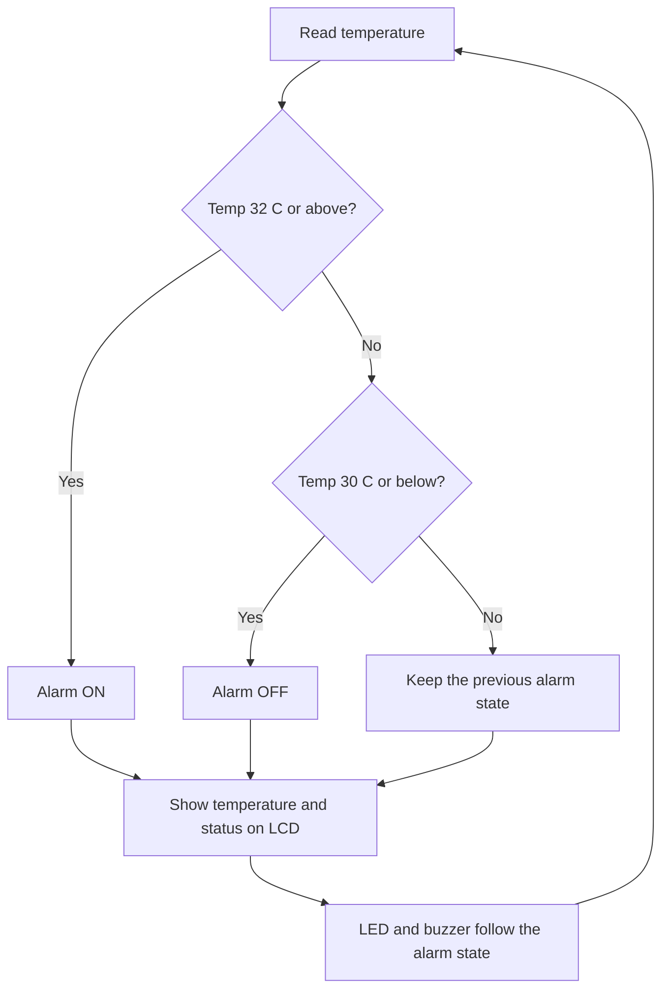

# Day 27: Digital Thermometer with High-Temperature Alarm

## Overview
Today I built a digital thermometer with a high-temperature alarm in Tinkercad Circuits. A temperature sensor feeds an Arduino Uno, which shows the live reading on a 16x2 I2C LCD and turns on a red LED and a buzzer when the temperature goes above a set limit. This report explains how the system senses, decides and acts.

## Block Diagram and Flowchart
**Block diagram**

`TMP36 temperature sensor → Arduino (compare with limit, with hysteresis) → I2C LCD + red LED + buzzer`

**Flowchart**



## How It Works
**Sense.** The TMP36 temperature sensor gives a voltage that rises with temperature, 10 mV per degree Celsius with 0.5 V at 0 °C. The Arduino reads it on A0 and converts the voltage to degrees with `temp = (voltage - 0.5) * 100`.

**Decide.** The code compares the temperature with two limits. The alarm turns on at 32 °C or above, and it only turns off again at 30 °C or below. This 2 °C gap is called hysteresis, and it stops the alarm from switching on and off rapidly when the temperature sits near the limit. Between 30 °C and 32 °C the alarm keeps whatever state it already had.

**Act.** The LCD shows the live temperature on line 1 and the status on line 2 ("Status: NORMAL" or "HIGH TEMP ALARM!"). When the alarm is on, the red LED lights and the buzzer sounds. When it is off, both stop. The same values are printed to the Serial Monitor.

## Components and Pins
| Part | Connection |
|---|---|
| TMP36 temperature sensor | signal to A0, with 5V and GND |
| 16x2 I2C LCD (address 0x27) | SDA to A4, SCL to A5, with VCC and GND |
| Red LED | pin 7 through a resistor to GND |
| Buzzer | pin 8 and GND |

The class sketch has the DHT11 lines commented out, so I used a TMP36 for the temperature in Tinkercad. It does not measure humidity.

## Alarm Test
**Limit used:** the alarm turns on at **32 °C** and turns off at **30 °C**.

**What happened:** when I moved the temperature slider on the TMP36 up to 32 °C, the red LED lit, the buzzer sounded and the LCD changed to "HIGH TEMP ALARM!". When I lowered the temperature, the alarm stayed on until the reading reached 30 °C, then it switched off and the LCD returned to "Status: NORMAL".

## Visuals
**Circuit**


**Code**


**LCD and Serial Monitor showing the alarm**


## Code
```cpp
#include <Wire.h>
#include <LiquidCrystal_I2C.h>

#define tmpSensor A0

const int redLed = 7;
const int buzzer = 8;

const float tempLimit = 32.0;   // alarm ON at or above this
const float tempReset = 30.0;   // alarm OFF at or below this

bool alarmOn = false;

LiquidCrystal_I2C lcd(0x27, 16, 2);

void setup(){
  pinMode(redLed, OUTPUT);
  pinMode(buzzer, OUTPUT);
  pinMode(tmpSensor, INPUT);
  Serial.begin(9600);
  lcd.init();
  lcd.backlight();
  lcd.setCursor(0,0);
  lcd.print("DIGITAL THERMO");
  lcd.setCursor(0,1);
  lcd.print("Starting......");
  delay(4000);
  lcd.clear();
}

void loop(){
  int reading = analogRead(tmpSensor);
  float voltage = reading * 5.0/1024.0;
  float temp = (voltage - 0.5)*100;

  if (temp >= tempLimit) {
    alarmOn = true;
  } else if (temp <= tempReset) {
    alarmOn = false;
  }

  digitalWrite(redLed, alarmOn ? HIGH : LOW);
  if (alarmOn) {
    tone(buzzer, 1000);
  } else {
    noTone(buzzer);
  }

  lcd.setCursor(0,0);
  lcd.print("Temp: ");
  lcd.print(temp, 1);
  lcd.print(" C   ");
  lcd.setCursor(0,1);
  lcd.print(alarmOn ? "HIGH TEMP ALARM!" : "Status: NORMAL  ");

  Serial.print("Temp: ");
  Serial.print(temp, 1);
  Serial.print(" C | ");
  Serial.println(alarmOn ? "ALARM ON" : "Normal");

  delay(500);
}
```

## What I Learned
- A thermometer senses with the TMP36, decides by comparing the temperature with a limit, and acts through the LCD, LED and buzzer.
- Hysteresis uses separate on and off limits (32 °C and 30 °C), so the alarm does not flicker near the limit.
- Overwriting old LCD text with trailing spaces avoids the flicker from `lcd.clear()`.
- A block diagram and a flowchart help plan the logic before writing the code.

## Conclusion
Day 27 turned a temperature sensor into a complete monitoring system: it measures, shows the reading and raises an alert. Adding hysteresis made the alarm steady and reliable.
