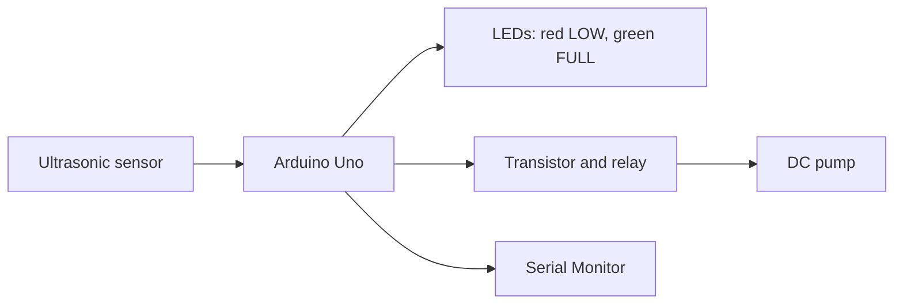
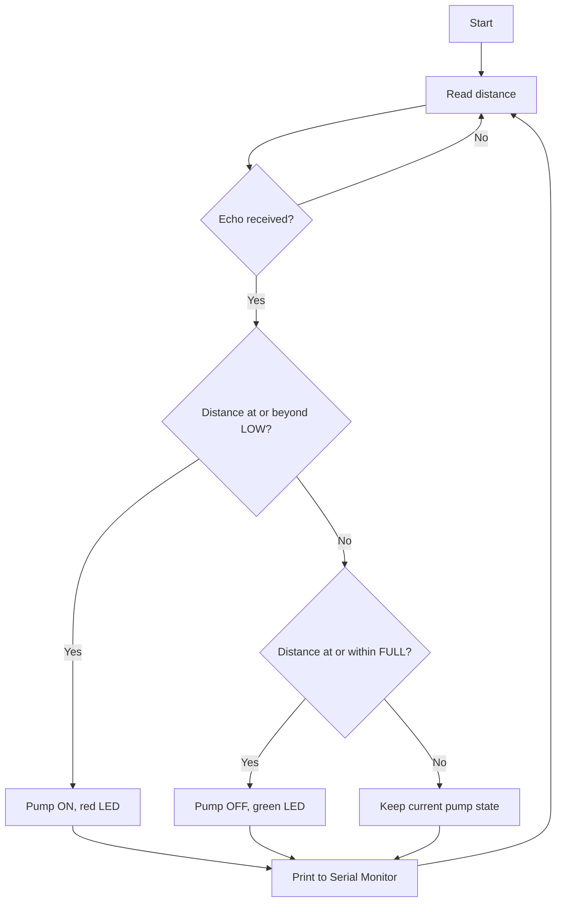

# Day 30: Review, Debugging and Project Planning

## Overview
Today was a review, debugging and planning session. I went back over this week's circuits, listed the faults I found and fixed along the way, and planned my project: an automatic water-level indicator and pump controller. I planned it with a pin table, a block diagram and a flowchart.

## Systematic Debugging
When something did not work, I checked it in the same order each time:
1. **Check the wiring.** Compare every wire with the pin table, including the power and ground wires.
2. **Test one part alone.** Run a small test sketch for that single component.
3. **Print what the Arduino sees.** Use the Serial Monitor to show readings and states.
4. **Change one thing at a time**, then test again.

### Faults I fixed this week
| Day | Symptom | Cause | Fix |
|---|---|---|---|
| 23 | Weather station showed °F instead of °C | The unit-toggle button was read the wrong way round | Checked the button wire and the code, then retested |
| 24 | Ultrasonic distance always read 0 | Sensor wires were on the wrong pins (the pin order is GND, 5V, SIG) | Swapped the wires to match the pin labels |
| 24 | Lock was always on | The button wire and buzzer wire were swapped on pins 2 and 4 | Swapped them back |
| 25 | LDR reading did not change with light | The LDR jumper was on GND instead of 5V | Moved the jumper to 5V |
| 26 | Serial Monitor was blank | Checked the code and Serial setup before reading again | Confirmed Serial.begin and the baud rate |

The Serial Monitor was the most useful debugging tool, because it showed me what the Arduino was really reading.

## Project Plan: Water-Level Indicator and Pump Controller

### Pin table
| Component | Arduino connection | Purpose |
|---|---|---|
| Ultrasonic sensor SIG | Pin 7 | Measures the distance to the water |
| Relay driver (transistor) | Pin 4 | Switches the pump |
| Red LED | Pin 8 | LOW level indicator |
| Green LED | Pin 12 | FULL level indicator |
| Sensor, LEDs, relay | 5V and GND | Power |

### Block diagram

### Flowchart

## Key Dependencies
1. **The ultrasonic sensor.** Every decision depends on its distance reading. If it reads wrongly, or reads 0, the whole system acts on bad information, so I check for no echo before deciding.
2. **Threshold logic with a gap (hysteresis).** The LOW and FULL values turn a measurement into a decision. The gap between them stops the pump from switching on and off rapidly near a limit.

## Visuals
**First working sub-circuit**

**A fault I fixed**

## What I Learned This Week
This week the most important thing I learned is to debug one step at a time instead of changing everything at once. Most of my faults were small, like a swapped wire or a jumper on the wrong rail, and I found them by comparing the circuit with the pin table and reading the Serial Monitor. Along the way I also learned how sensors, conditional logic, displays and relays work together in one system. In my water-level project I will build and test each part alone first: the sensor, then the LEDs, then the relay and pump. I will print every reading to the Serial Monitor so I can see where a fault starts.

## Conclusion
Week 6 moved me from building single circuits to planning and debugging a whole system. A pin table, a block diagram and a flowchart gave me a plan I can build and test step by step.
